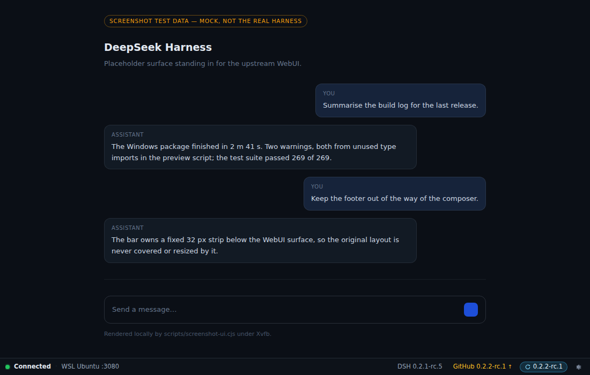
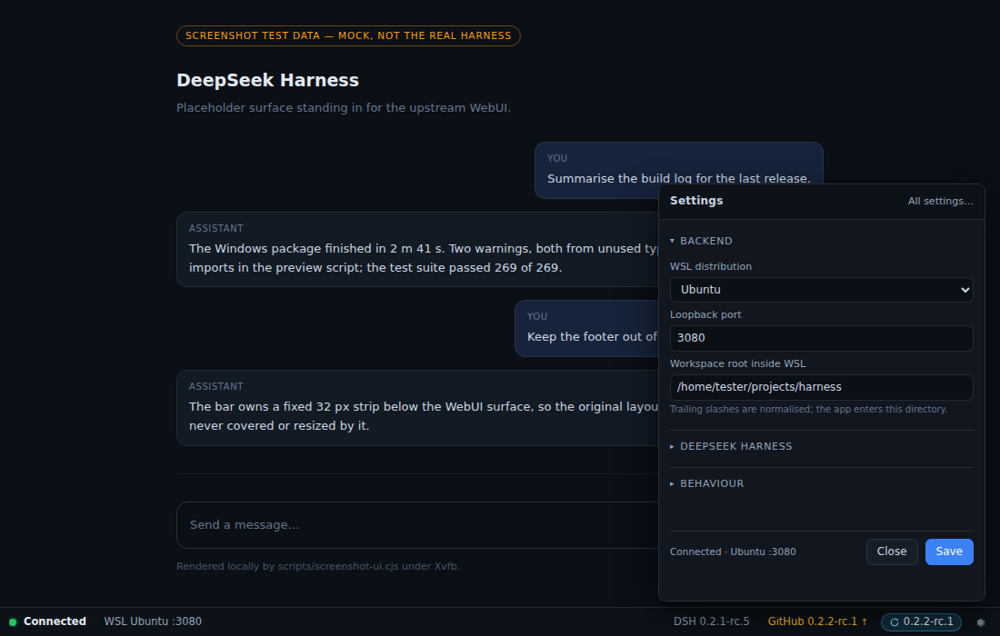
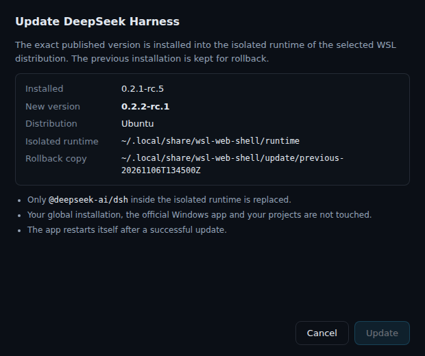

<h1 align="center">DSH WSL</h1>

<b>The original DeepSeek Harness WebUI in a real Windows window, running on your own WSL2.</b>

<b>English</b> · <a href="README.ru.md">Русский</a>

  
  
  
  
  

  <a href="https://github.com/triagmas/dsh-wsl/releases"><b>⬇ Download for Windows (x64)</b></a>

DSH WSL is a small Electron shell for WebUIs that run inside WSL2. The first backend
is the native **DeepSeek Harness** (`dsh web`): DSH WSL starts it in your existing
distribution and displays the **untouched official WebUI** — the same interface with
the same capabilities — in a desktop window without browser tabs or an address bar.
No replica UI, no patched upstream build, no duplicated chat interface.

DSH WSL runs **your existing `dsh`** — the same executable an ordinary `dsh web` in a
WSL terminal starts — and keeps its **data** in its own profile
(`~/.local/share/wsl-web-shell`, with its own `DSH_HOME`), so sessions, projects and
credentials of the official Windows DeepSeek Harness are never touched. Because that
`DSH_HOME` is separate, sessions you created through the app are not shared with a
`dsh web` you start in a terminal. Isolation can be switched off in the settings to use
your normal `~/.dsh` data as well.

> **Release status.** The current published prerelease is
> [`v0.1.0-beta.2`](https://github.com/triagmas/dsh-wsl/releases/tag/v0.1.0-beta.2) —
> built from `main@a9e9446` by Windows CI run
> [`42474816421`](https://github.com/triagmas/dsh-wsl/actions/runs/42474816421). It ships
> both variants from that one commit:
> [`DSH-WSL-0.1.0-x64-Portable.exe`](https://github.com/triagmas/dsh-wsl/releases/download/v0.1.0-beta.2/DSH-WSL-0.1.0-x64-Portable.exe),
> [`DSH-WSL-0.1.0-x64-Setup.exe`](https://github.com/triagmas/dsh-wsl/releases/download/v0.1.0-beta.2/DSH-WSL-0.1.0-x64-Setup.exe)
> and [`SHA256SUMS.txt`](https://github.com/triagmas/dsh-wsl/releases/download/v0.1.0-beta.2/SHA256SUMS.txt).
> The older
> [`v0.1.0-beta.1`](https://github.com/triagmas/dsh-wsl/releases/tag/v0.1.0-beta.1)
> predates the rename and contains a single portable EXE under the old
> `WSL-Web-Shell-…` name. There is no stable release yet — both are prereleases.

## What you get

**Your own WSL, your own data.** Agents, models, tools and project files stay inside
your Linux distribution. DSH WSL never silently changes WSL, Node.js or a globally
installed `dsh`, and it never touches the official Windows DeepSeek Harness installation
or your projects. It does not update anything by itself: when a newer release exists it shows the
installed and available version and the exact commands, and one button runs those same
commands in a visible WSL console where `sudo` can ask you for your password — you watch
it, and the app never sees the password.

**A window that behaves like an app.**

Closing the window keeps the app in the tray: *Focus window*, live *Status*,
*Restart WebUI*, *Settings*, *Quit*. The backend is supervised — if it dies, DSH WSL
restarts it with bounded retries and shows an honest reconnecting state instead of a
blank page.

**A thin status bar, never a second UI.** The app-owned 32 px bar shows the live
connection state, the running DSH version and the latest GitHub release. The gear
opens a compact settings popover (distribution, port, isolation, workspace) — the
WebUI itself is never modified.

| Footer bar | Settings popover |
|---|---|
|  |  |

**A manual, honest update.** When a newer published release exists, the bar offers it.
The window names the installed and available version, the distribution and the
executable, and shows the commands you run yourself. Only the commands change: nothing
is stopped, installed or written by the app. A systemd unit behind an attached backend
is named read-only, with `sudo systemctl stop/start` for a system unit and
`systemctl --user` for a user unit; a hand-started or app-owned backend gets the install
line and an instruction to stop it first. pnpm gets `pnpm add -g`. When the manager,
version or target cannot be established, no command is invented — the window says why.
Each line has its own **Copy** button and there is **Copy all**; **Check again** runs
the read-only inspection once more.

## Portable or Setup

Both packages are built from the same commit and behave the same; pick how you want
the app to live on your machine.

| | **Portable** | **Setup** |
|---|---|---|
| File | `DSH-WSL-<version>-x64-Portable.exe` | `DSH-WSL-<version>-x64-Setup.exe` |
| Installation | none — double-click to run | normal Windows setup wizard |
| Admin rights | none | none (per-user) |
| Shortcuts | none | Start-menu entry, optional desktop shortcut |
| Uninstall | delete the EXE | Installed apps → *DSH WSL* → Uninstall |

Both share the same profile (`%APPDATA%\wsl-web-shell`), the same isolated data
directory in WSL and therefore the same shared `dsh` installation, so settings and the
DeepSeek Harness version are the same whichever you start.
Details, installer behaviour and CI checks: [docs/packaging.md](docs/packaging.md).

## Quick start

**You need:** Windows 10/11 x64 with WSL2, an existing distribution (default preset
`Ubuntu`) and the DeepSeek Harness CLI `dsh` installed **by you** inside it (for example
`npm install -g @deepseek-ai/dsh`). DSH WSL never installs a copy of its own.

1. Open the
   [v0.1.0-beta.2 release](https://github.com/triagmas/dsh-wsl/releases/tag/v0.1.0-beta.2)
   and download `DSH-WSL-0.1.0-x64-Portable.exe` (no install) or
   `DSH-WSL-0.1.0-x64-Setup.exe`, then verify it against the `SHA256SUMS.txt` published
   with it. The binaries are unsigned, so SmartScreen may warn about an unknown
   publisher. Builds from Windows CI (`dsh-wsl-windows-x64` artifact) are development
   artifacts for testing unreleased commits, not a substitute for the published files.
2. Start DSH WSL. The orbital splash shows the real startup stages: WSL check,
   locating your `dsh`, backend start, token exchange.
3. The official WebUI appears as soon as the backend is ready. Change the
   distribution, port or isolation mode from the gear if needed.
4. When a new DeepSeek Harness release is published, use the pill in the status bar.
   The window names the executable, the npm prefix and the versions; copy the commands
   and run them in a WSL terminal, then press **Check again**. DSH WSL itself changes
   nothing.

## Documentation

| | |
|---|---|
| [Packaging: Portable and Setup](docs/packaging.md) | artifacts, installer, CI |
| [Architecture](docs/architecture.md) | process model, supervisor, window composition |
| [Specification](docs/spec.md) | state machine, tray lifecycle, security rules |
| [Footer bar and settings](docs/footer.md) | the app-owned chrome |
| [Manual update](docs/update.md) | versions, commands, read-only inspection |
| [Upstream contract](docs/upstream-dsh-web.md) | how `dsh web` is started and verified |
| [Diagnostics and support](docs/diagnostics.md) | logs, profile, failure states |
| [Development](docs/development.md) | commands, tests, layout |
| [Evidence](docs/evidence/r02.md) | real acceptance runs with artifact and SHA-256 |

## Verification

CI runs typecheck, lint, unit tests (source-invariant and Electron-free logic), render
smoke tests of the app-owned surfaces, a real-screen paint probe and the Windows
packaging job that installs, launches and uninstalls both variants. Real acceptance
runs on a live Windows 11 + Ubuntu WSL2 machine are recorded in
[docs/evidence/r02.md](docs/evidence/r02.md), [docs/evidence/r09.md](docs/evidence/r09.md)
and [docs/evidence/r091.md](docs/evidence/r091.md). Source-level green checks are never
presented as a substitute for those runs.

## License

MIT — see [LICENSE](LICENSE). No DeepSeek model weights and no official Windows
desktop binaries are redistributed.
