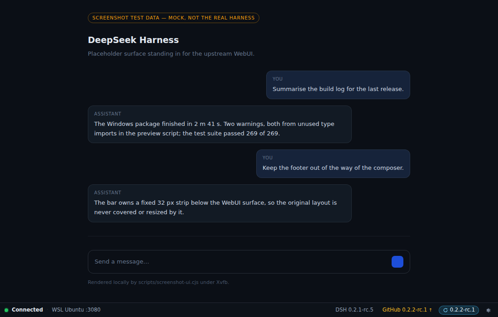
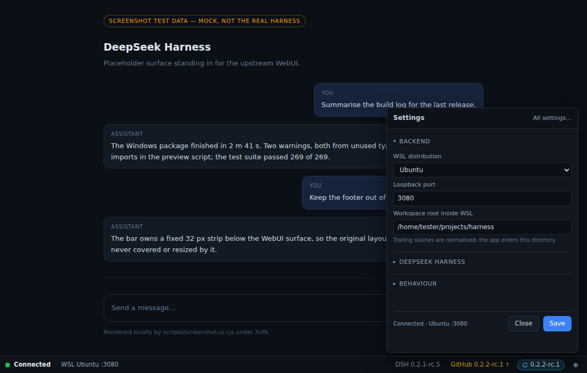

# Footer bar and settings popover (issue #9)

The main window is a **32 px app-owned bar plus the untouched upstream WebUI**. The
bar never draws over the remote page: the WebUI lives in its own `WebContentsView`
placed above the bar, so the original layout, composer and scrolling are unchanged.

Both screenshots are rendered by `npm run screenshots` under Xvfb from the shipped
pages and preloads, with fixed test data and a **mock** upstream surface. They are
not a screenshot of the real DeepSeek Harness and contain no owner data.

## Left side: connection

| Element | Source | Notes |
|---|---|---|
| Coloured dot + word | supervisor status | `ok` (READY, HIDDEN_IN_TRAY), `warn` (CHECKING, STARTING_*, CONNECTING, RECOVERING), `error` (ERROR), `idle` (QUITTING) |
| `WSL <distro> :<port>` | status snapshot | shows the configured distro and the port actually in use |

Colour is never the only signal: the state is always written out, and the dot is
`aria-hidden` with the word carrying the meaning. On narrow windows the endpoint is
dropped first, then the state word is shortened (`chrome.css` media queries).

## Right side: versions

| Element | Source | Behaviour |
|---|---|---|
| `DSH <version>` | `dsh --version` inside the distro, read by the supervisor | `DSH —` until the backend has answered; never guessed |
| `GitHub <version>` | `https://api.github.com/repos/deepseek-ai/deepseek-harness/releases` | newest published `dsh-v*` release; `GitHub …` while unknown |
| `↑` | comparison of the two | shown only when upstream is strictly newer (SemVer precedence including pre-releases) |
| `⟳ <version>` | same comparison | pill with a circular arrow; **hidden unless** a newer release is published, opens the update window (issue #12; commands or one **Run in WSL console** button) |

Rules:

- The GitHub lookup is **informational only**: it downloads nothing and sends no
  credentials or cookies. The only action it enables is the manual instruction window
  described in [update.md](update.md), which shows commands the owner runs; the app
  changes nothing.
- Results are cached in `userData/versions-cache.json` for 18 h so a restart or a
  network outage never blocks or delays startup. A failed refresh keeps the last good
  version and only records a short error.
- The response is capped at 512 KiB, `redirect: 'error'`, one hard-coded origin and
  an 8 s timeout.
- Clicking the GitHub label opens the release page through the system browser, and
  only the URL that came back from that lookup can be opened.

## Gear: settings popover

A frameless popover (360×460) anchored to the gear, opened via
`footer:toggle-settings` with the gear rect as the anchor. Placement is computed in
`computePopoverBounds` and clamped to the working area of the current display.

It contains the **existing** settings in three collapsible groups — Backend,
DeepSeek Harness, Behaviour — plus "All settings…" for the full window. Every value
goes through the unchanged `settings:save` handler, so `applyConfigPatch` validation,
restart-required detection and canonical re-rendering are the same as before. The
popover keeps no state of its own: after a save it re-reads `settings:load`.

## Live status in the popover

The popover is a separate window, so it receives `shell:status` like the main and
splash windows: `Windows.publishStatus` fans out to `main`, `splash`, `settings`
and `popover`. Without the popover in that list it kept the state it read at open
time — a backend that went `RECOVERING` while the popover was open still said
"Connected". `tests/r09.test.ts` pins the fan-out list and
`npm run composition:smoke` proves it against a real open popover window.

## Where the workspace rule lives

Settings and the launcher share `src/main/core/workspace.ts` (issue #8):

- accepted: `~`, `~/`, `~/projects`, `/home/user/projects` and any of those with
  trailing slashes;
- normalised: trailing slashes are removed before the value is stored or launched
  with, so `~/projects/` and `~/projects` are the same setting and do not trigger a
  restart;
- rejected: empty/whitespace, `/`, relative paths, `~user/...`, `.`/`..` segments,
  empty segments (`/a//b`), backslashes and control characters.

## Verification

- `tests/footer.test.ts` — tone/label mapping, version labels, view and popover
  geometry, anchor validation, and a guard that `--footer-height` matches
  `FOOTER_HEIGHT`.
- `tests/versions.test.ts` — version parsing, SemVer precedence, release selection,
  cache TTL, offline behaviour, size cap and "no credentials".
- `tests/workspace.test.ts` — the shared workspace contract across Settings and the
  launcher, including legacy configs with a trailing slash.
- `tests/r09.test.ts` — composition guards: WebUI stays in a `WebContentsView` with
  its sandbox and navigation allowlist, no CSS/DOM injection into remote pages, all
  new IPC channels go through the trusted-sender guard, the popover anchor is
  validated, installation never changes outside the plan built for the manual window (issue #17),
  and issue #7's automation mode stays out.
- `npm run chrome:smoke` — renders the shipped footer and popover under Xvfb and
  asserts 36 observable facts (labels, tone, arrow, release click, bar height,
  groups, pre-filled values, save round-trip, close). Runs in CI.
- `npm run composition:smoke` — builds the **real** `Windows` class and drives it
  the way the app does: a `BrowserWindow` with the footer page, the
  `WebContentsView` on the production partition, the production preloads and
  `computeViewBounds`. A local HTTP server stands in for `dsh web` (issues a
  session cookie on the first request, answers 401 on a wrong one). It asserts 28
  facts: bar height and position, distro/port/state/version labels, view origin
  and full-width bounds ending exactly where the bar starts, no overlap, layout
  after growing and shrinking the window, cookie stored in the app partition, a
  forced reload reusing that cookie with no 401, and a status change reaching an
  already open settings popover. Runs in CI.

## Deliberately out of scope

- No auto-update, no version pinning UI, no changelog rendering.
- No new settings fields and no change to the splash or to issue #7 behaviour.
- Nothing is read from or written to the Windows DeepSeek Harness installation.
